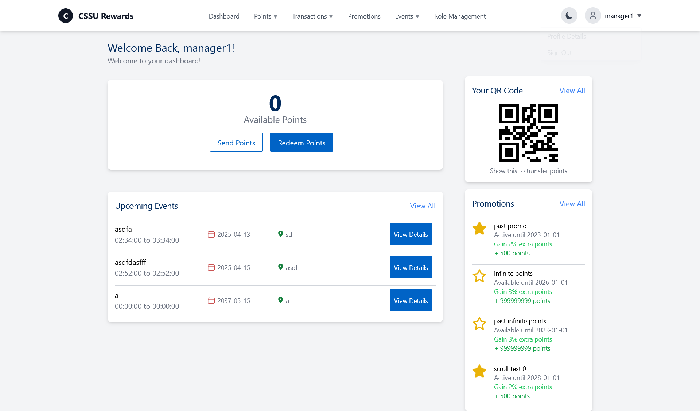
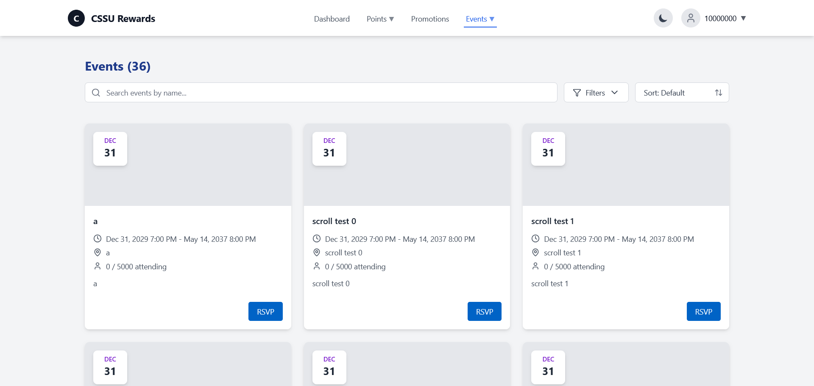
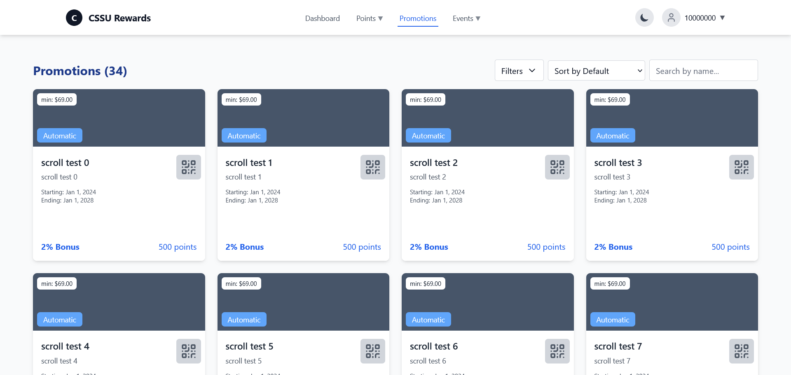
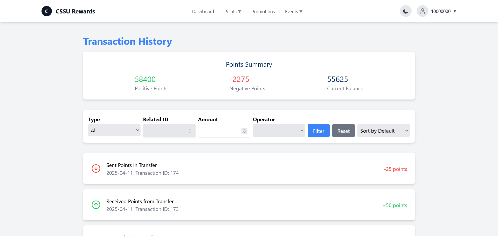
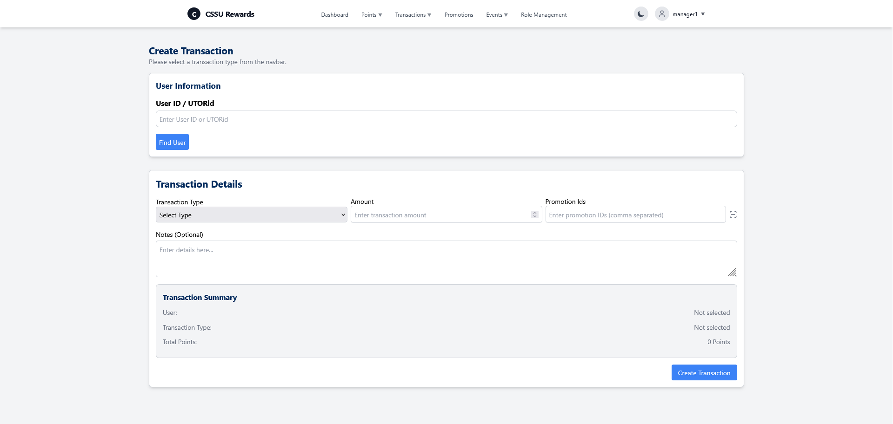
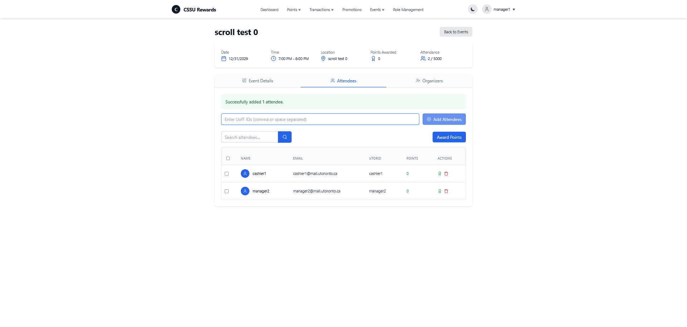
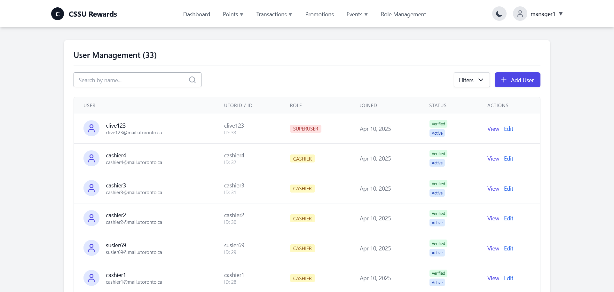

<p align="center">
  
</p>

<h1 align="center">CSSU Rewards</h1>

<p align="center">A points and rewards system for the Computer Science Student Union at the University of Toronto.</p>

<p align="center">
  <a href="https://cssu-rewards-ad54.vercel.app">Live demo</a>
</p>

<p align="center">
  
  
  
  
  
  
</p>

CSSU Rewards runs the point system for the CS student union. Students earn points from purchases recorded by staff, event attendance and promotions. They can send points to each other and redeem them for rewards at the counter. Staff use the same app to manage accounts, events, promotions and redemption requests.

The project started as a CSC309 (Software Design) course project in Winter 2025 and was entered in a competition to design the CSSU points system.



*Dashboard with available points, a personal QR code, upcoming events and active promotions.*

## Screenshots

| | |
| --- | --- |
|  <br> *Browse events and RSVP* |  <br> *Automatic and one-time promotions* |
|  <br> *Point summary, filters and history* |  <br> *Record purchases, adjustments and other transactions* |
|  <br> *Manage attendees and award points* |  <br> *Roles, verification and account status* |

## Features

- Point ledger for purchases, adjustments, transfers, event awards and redemptions.
- Promotions with a minimum spend, bonus rate, fixed points, one-time use and QR codes.
- Events with organizers, guest lists, capacity limits, point budgets and attendance awards.
- Role-based access for regular students, cashiers, managers and superusers.
- Account lifecycle with activation tokens, password resets, avatar uploads, verification and suspicious flags.
- Redemption flow where a student requests points and staff scan the QR code to confirm.

## Roles

| Role | Can do |
| --- | --- |
| Regular | Browse published events, RSVP, send and redeem points, edit their profile, view their own history |
| Cashier | Everything a regular student can do, plus look up users, create accounts, record purchases and process redemptions |
| Manager | Everything a cashier can do, plus manage events and promotions, adjust points, verify users, flag transactions and assign roles up to cashier |
| Superuser | Full access, including promoting users to manager |

## Tech stack

| Layer | Technology |
| --- | --- |
| Frontend | React 19, TypeScript, Vite 6, Tailwind CSS 3, React Router 7 |
| Express API | Node.js, Express 4, Prisma 6, PostgreSQL, Zod, JSON Web Tokens, bcrypt |
| Spring API | Java 21, Spring Boot 3.5, Spring Security, Spring Data JPA, Flyway, PostgreSQL or SQLite |
| Tests | Jest and Supertest for Express, JUnit and MockMvc on H2 for Spring |

## Repository layout

```
backend/         Express and Prisma API, the original implementation
backend-spring/  Spring Boot port of the same API
frontend/        React single-page app
docs/            Screenshots used in this README
```

## Running the app

### Prerequisites

- Node.js 18 or newer
- PostgreSQL 14 or newer for Express or Spring's default database mode. Spring can also use SQLite without a database server.
- Java 21 if you want to run the Spring backend

### 1. Express backend

```bash
cd backend
cp .env.example .env
```

Set `DATABASE_URL` and a random `JWT_SECRET` in `.env`, then install and start the API:

```bash
npm install
npm run seed
npm run dev
```

The API listens on http://localhost:3000. `npm run seed` drops and recreates the schema, then loads sample users, events and promotions. To skip the sample data, run `npm run reset` instead. Both commands destroy existing data, so use them only against a development database.

The seeded manager account is `manager1` with password `20952`.

### 2. Frontend

```bash
cd frontend
cp .env.example .env
npm install
npm run dev
```

Open http://localhost:5173. The example environment file points the app at http://localhost:3001, where the Spring backend listens. To use Express locally instead, set `VITE_BACKEND_URL=http://localhost:3000`.

### 3. Spring backend

```bash
cd backend-spring
```

Set `DB_URL`, `DB_USER`, `DB_PASSWORD` and a `JWT_SECRET` of at least 32 bytes, then run:

```bash
./mvnw spring-boot:run
```

On Windows use `./mvnw.cmd`. The Spring API listens on http://localhost:3001, which is the frontend's default when `VITE_BACKEND_URL` is unset. For a demo instance, set `DEMO_MODE=true` in Spring's process environment and `VITE_DEMO_MODE=true` in the frontend `.env` before building. This disables password reset and password changes and hides their UI. Both default to `false`; do not use the existing reset flow with real accounts (see [the Spring backend warning](backend-spring/README.md)).

Flyway creates the schema on first start, so use an empty database. Do not point it at the Express database. To create the first superuser, start the app with `BOOTSTRAP_SUPERUSER_UTORID`, `BOOTSTRAP_SUPERUSER_EMAIL` and `BOOTSTRAP_SUPERUSER_PASSWORD` set, and remove those variables once the account exists. More detail is in [backend-spring/README.md](backend-spring/README.md).

For a single-instance SQLite demo, set `SPRING_PROFILES_ACTIVE=sqlite` and
`DEMO_MODE=true`, plus `JWT_SECRET`. The default file is `./rewards.db`; set
`SQLITE_URL` to choose another location. PostgreSQL remains the default, and
switching databases does not migrate existing data. See the
[SQLite setup and storage limits](backend-spring/README.md#sqlite-demo).

### Docker demo proposal

For a proposed single-image Spring + React deployment, see the
[Docker demo assessment and sample Compose file](docs/docker/README.md).
The combined image is not implemented or published yet.

## Tests

```bash
cd backend
npm test

cd ../backend-spring
./mvnw test
./mvnw -Psqlite-tests test

cd ../frontend
npm run lint
npm run build
```

The Express tests generate a temporary SQLite schema and restore the PostgreSQL client when they finish. The Spring tests use H2 by default; `-Psqlite-tests` runs the same suite against SQLite. Spring also tests SQLite restart persistence. Neither suite touches the development database.

## API

All routes require a bearer token except login and password reset. The API is grouped by resource:

| Prefix | Contents |
| --- | --- |
| `/auth` | Login, password reset and account activation |
| `/users` | Profiles, avatars, staff user management, transfers, redemptions, personal transaction and event lists |
| `/transactions` | Purchases, adjustments, transaction search and redemption processing |
| `/events` | Events, organizers, guests and attendance awards |
| `/promotions` | Promotions and their QR codes |

## Demo

A hosted version runs at https://cssu-rewards-ad54.vercel.app.

```
UTORid:   Clive123
Password: Clive123
```

## Project status

The Express backend is the original implementation. The Spring Boot port implements the same API surface and passes its own test suite, but its responses have not been checked field for field against Express. See [backend-spring/README.md](backend-spring/README.md) for what it covers and what still needs work.

## License

MIT. See [LICENSE](LICENSE).
